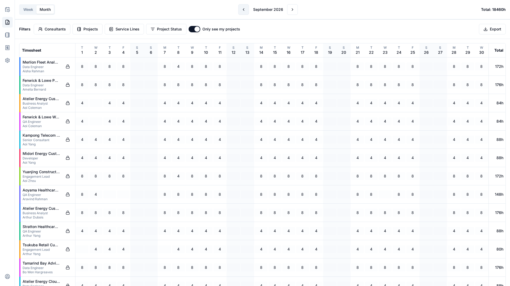
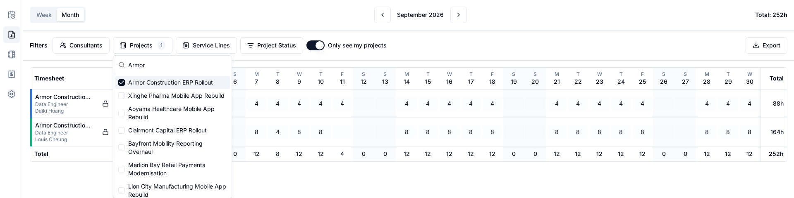
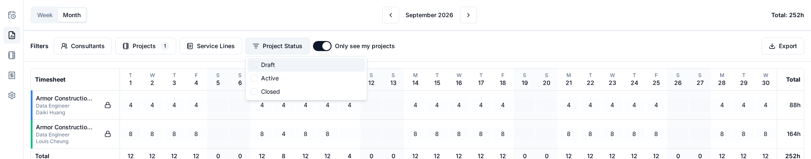
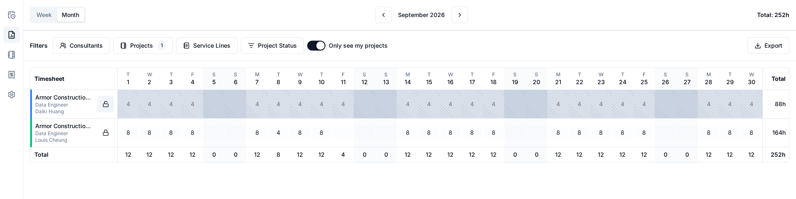
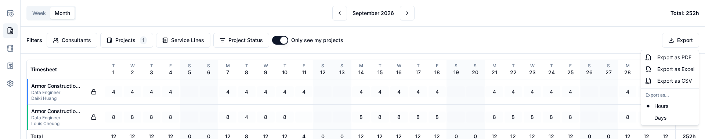
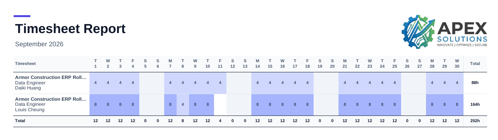

# Reporting

Reporting is for users with the **manager** role. It shows the hours of every consultant, lets
you correct them, lock a period and export what you see.

You can review, correct and lock hours on **any** project. Being listed as one of a project's
managers (see [Projects](projects.md)) only decides what you see by default.

## The screen

The period selector works as on the [timesheet](timesheet.md): Week or Month, with arrows to move.
Below it are the filters, the **Only see my projects** switch and the **Export** button, then
the grid.

[{ .media }](../static/img/timesheet/reporting-overview.png)

Each row is one consultant on one service line, labelled with project, service line and consultant
name. Rows are ordered by consultant name, then project, then service line.

A consultant assigned to a service line in view gets a row even when they logged nothing in the
period, so you can review and lock it. Someone who was removed from a line still appears for any
period in which they have hours there.

## Filters

Four filters narrow the grid:

- **Consultants**, **Projects** and **Service Lines**: searchable lists of checkboxes.
- **Project Status**: Draft, Active or Closed.

Filters combine (a row must match all of them), an unchecked filter means "no restriction", and
your selections stay when you change period.

[{ .media }](../static/img/timesheet/reporting-filter-projects.png)

[{ .media }](../static/img/timesheet/reporting-filter-status.png)

<video class="media" controls muted loop playsinline preload="metadata" width="100%">
  <source src="../../static/img/timesheet/reporting-filters.mp4" type="video/mp4">
</video>

*Picking a month, then narrowing the grid with the filters.*

## Only see my projects

The **Only see my projects** switch, after the filters, is **on** every time you open Reporting.
While it is on, the grid, the filter lists and exports cover only the projects you are listed on
as a manager. If you are listed on none, the grid is empty.

Turn it off to see every project, including deleted ones: Reporting keeps their hours as a
historical record. Turning it back on removes any project, service line or consultant you had
selected that is not part of your projects, along with their rows. Your Project Status selection
stays.

## Correct hours

Click an unlocked cell and edit it exactly as a consultant does; it saves when you leave the cell.
The entry then records you as the person who last changed it. You can edit rows of any project, but
never a locked cell: unlock the period first.

## Lock and unlock

Each row has a lock button. It locks the consultant's service line for **every day of the period in
view** in one click:

- a closed lock means "click to lock" (shown whenever any day in the period is not yet locked),
- an open lock means "click to unlock" (shown only when every day of the period is locked).

There is no confirmation dialog. Locking is a plain edit freeze: consultants can no longer change
those cells and neither can you until the period is unlocked. It is not an approval step.

Things to know:

- Locking also locks days with no hours, so nobody can add time to a finished period afterwards.
  Unlocking removes those empty placeholders again and leaves real hours untouched.
- Hours are never changed by locking or unlocking.
- You can lock a consultant who has been deactivated but is still on the line, so a leaver's last
  timesheet can be closed.
- A row on a closed project shows its real hours, can still be locked, and is read-only.
- The lock button always refers to the period in view: a locked week shows the closed lock ("click
  to lock") again after you switch to the month, because the rest of the month is not locked.

[{ .media }](../static/img/timesheet/reporting-locked.png)

<video class="media" controls muted loop playsinline preload="metadata" width="100%">
  <source src="../../static/img/timesheet/reporting-lock.mp4" type="video/mp4">
</video>

*Locking and unlocking a row.*

## Export

**Export** offers three formats. The file reflects the current period, filters and **Only see my
projects** switch, and is built from the saved data, so finish any edit before exporting.

| Format | Contents |
|---|---|
| **PDF** | Landscape A4 report titled "Timesheet Report" with the period as subtitle. If an organization logo is uploaded and enabled in the settings, it appears at the top. |
| **Excel** | Two sheets: **Report** (the grid with totals, one column per day) and **Details** (one row per entry: project, service line, consultant, date, hours). |
| **CSV** | The same one-row-per-entry data as the Details sheet, as UTF-8 comma-separated text. |

Below the formats, **Export as…** chooses the unit: **Hours** (the default) or **Days**. Days
divides every value by the [Standard Workday Length](administration.md#standard-workday-length) an
administrator sets under Configuration → General (8 hours unless changed), so with an 8-hour day a 4-hour entry reads 0.5. The choice applies to
whichever format you pick next, and is not remembered: the menu starts on Hours each time you open
Reporting.

| Format | In days |
|---|---|
| **PDF** | Values show up to three decimals without trailing zeros (1, 0.5, 0.625), the totals end with **d** instead of **h**, and a value too wide for its cell is printed in a smaller font. |
| **Excel** | Exact values, displayed with up to three decimals. The value column of **Details** is headed **Days**. |
| **CSV** | The value column is headed **Days** and holds the value rounded to five decimals. |

Totals are worked out from the exact hours and converted last, so a total in the PDF can differ in
its last digit from the sum of the rounded cells above it.

File names are built from the period and, when a single project or consultant is selected, their
names: for example `august-2026_meridian-web-app_john-wayne.pdf`, or `2026-week-36.xlsx` with no
filter.

[{ .media }](../static/img/timesheet/reporting-export-menu.png)

[{ .media }](../static/img/timesheet/reporting-pdf.png)

<video class="media" controls muted loop playsinline preload="metadata" width="100%">
  <source src="../../static/img/timesheet/reporting-export.mp4" type="video/mp4">
</video>

*Exporting the filtered period as a PDF.*

## On a phone

Below tablet width the grid becomes a strip of day chips, as on the [timesheet](timesheet.md):
select a day to see each consultant's service line for it. The period selector, filters, the
**Only see my projects** switch and **Export** sit above the strip, and the lock button on a row
locks the period in view.

  
  
  

<video class="media" controls muted loop playsinline preload="metadata" width="280">
  <source src="../../static/img/timesheet/reporting-phone.mp4" type="video/mp4">
</video>

*Filtering, locking and exporting on a phone.*
