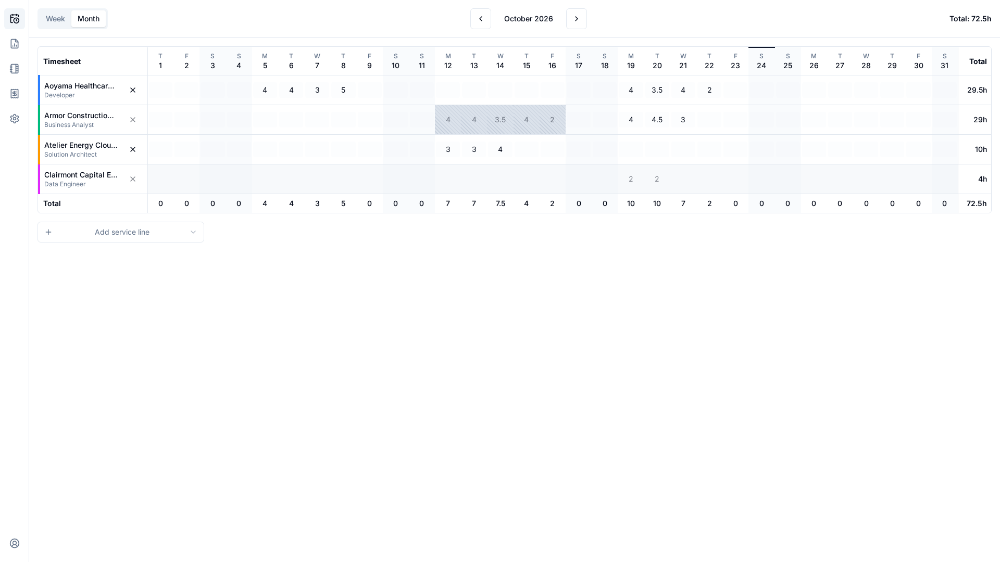
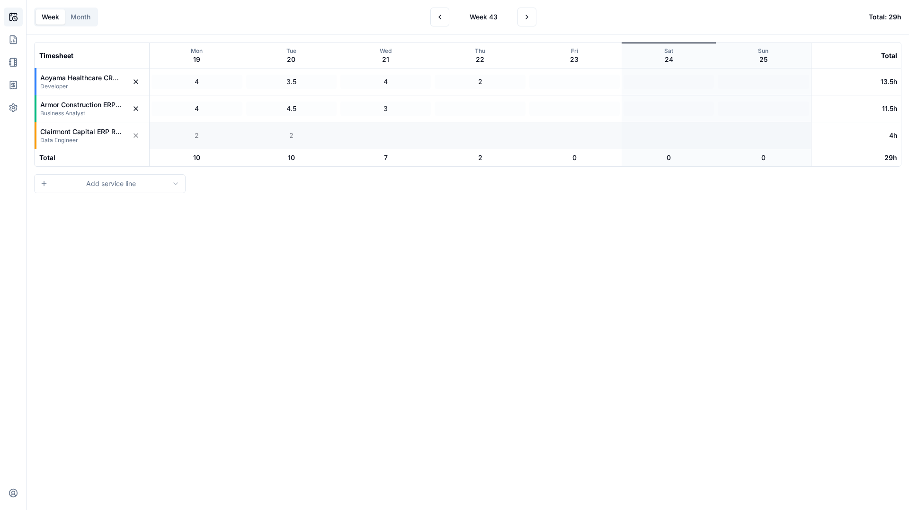
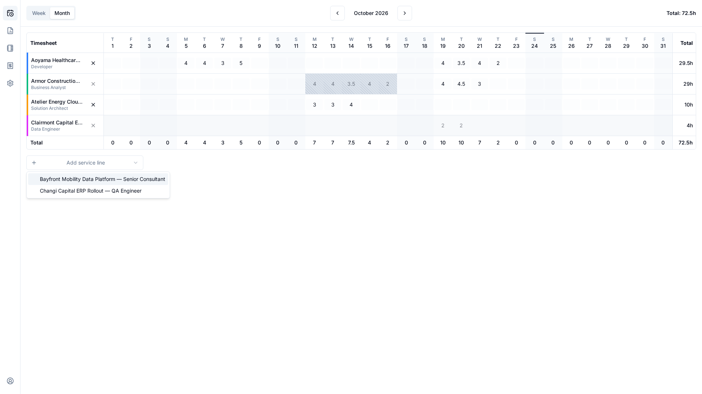
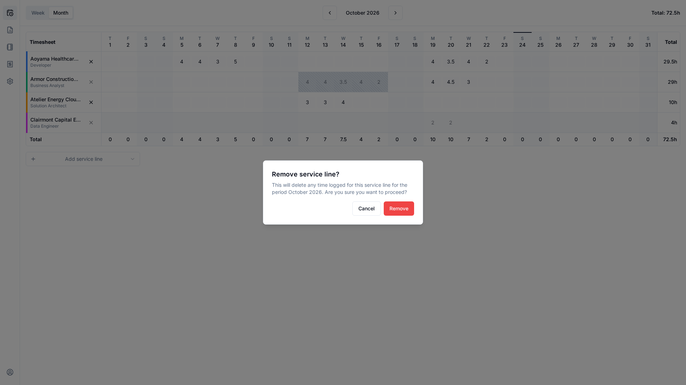
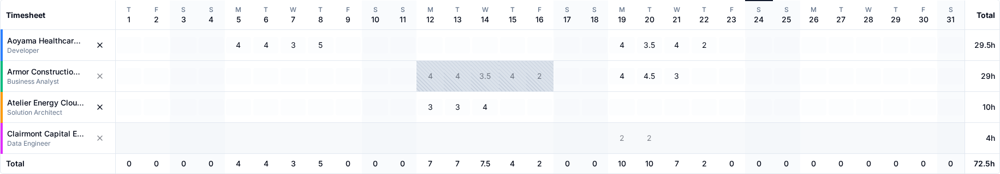

# Timesheet

The timesheet is the first screen after you sign in, and every user has one. It shows your own
hours, one row per service line and one column per day.

<video controls muted loop playsinline preload="metadata" width="100%">
  <source src="../../static/img/timesheet/desktop-enter-hours.mp4" type="video/mp4">
</video>

*Adding a service line and entering hours on a desktop.*

## Choose a period

Use the **Week / Month** switch and the previous and next arrows to move around. Weeks start on
Monday. A phone opens on the week view and a larger screen on the month view. Dates and "today"
follow your browser's time zone.

<video controls muted loop playsinline preload="metadata" width="100%">
  <source src="../../static/img/timesheet/desktop-periods.mp4" type="video/mp4">
</video>

*Moving between weeks and months.*

## Which rows you see

The rows for a period are:

- the service lines you added yourself while viewing that period, and
- every service line on which you have logged hours in that period, even if you have since been
  taken off it, so your history stays visible.

Rows are sorted by project name, then service line name. Rows you add do not follow you to other
periods; they simply reappear in any period where they hold hours.

### Add a service line

Choose **Add service line** and pick one from the list. Only service lines that you are assigned to,
on projects that are **Active**, are offered. If a line you expect is missing, ask a manager to
assign you to it, or to set its project to Active.

### Remove a service line

Use the remove control on a row. A row with no hours in the period simply disappears. A row with
hours asks for confirmation and then clears the hours it holds in that period. If any day of the
period is locked, the row cannot be removed.

<video controls muted loop playsinline preload="metadata" width="100%">
  <source src="../../static/img/timesheet/desktop-remove-service-line.mp4" type="video/mp4">
</video>

*Removing a row with no hours, then a row with hours.*

## Enter hours

Click a cell and type the hours. Values go from 0 to 24 in steps of 0.5. A value outside that range
or not on a half hour is corrected automatically to a valid value when you leave the cell.

- **Saving is automatic**, when you leave the cell. There is no submit button.
- Day totals, line totals and the period total update as you type.
- Entering 0 clears the day.

## Cell states

| State | Meaning |
|---|---|
| **Open** | You can edit it. |
| **Locked** | A manager froze this period for you. It is read-only and shown with a distinct fill, even if you are no longer assigned. Only a manager can unlock it. |
| **Unassigned** | You are no longer assigned to this line, or its project is not Active. It is read-only and greyed out; hover for the reason. |

A locked cell takes precedence over an unassigned one.

<video controls muted loop playsinline preload="metadata" width="100%">
  <source src="../../static/img/timesheet/desktop-locked-and-unassigned.mp4" type="video/mp4">
</video>

*Locked and unassigned cells cannot be edited.*

A save can be refused if the day was locked or you were unassigned in the meantime. Other cells you
changed are still saved independently.

## On a phone

Below tablet width, the grid becomes a strip of day chips. Select a day to see its service lines
and enter hours for it. Both layouts read and write the same data.

  
  
  

<video controls muted loop playsinline preload="metadata" width="280">
  <source src="../../static/img/timesheet/phone-enter-hours.mp4" type="video/mp4">
</video>

*Entering hours on a phone.*
